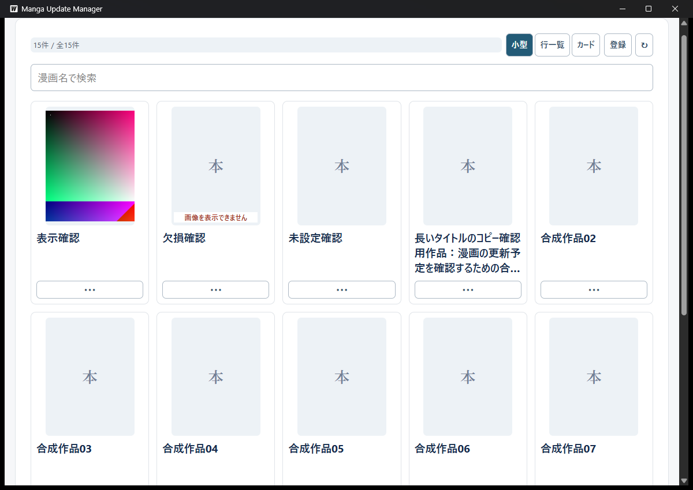
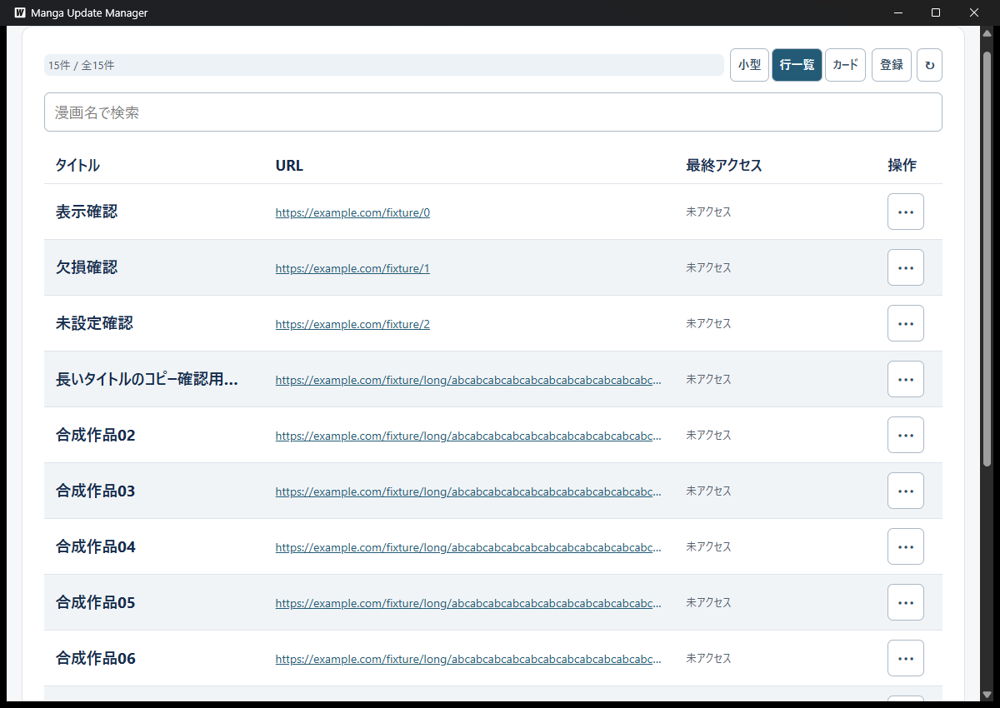
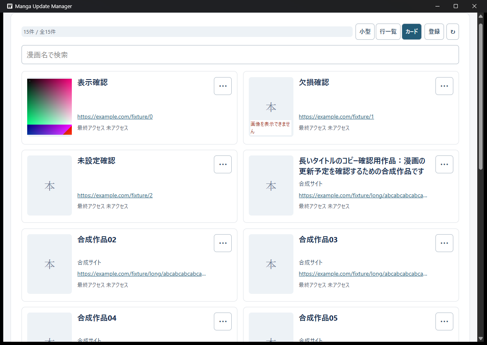

# 3形式と表示設定の実WebView2確認

Issue #237、親#44。2026-10-24、基準main `a92a456bf92e28be87b3ef892b176eb7ad246e8c`（PR #253）で確認した。実画面で操作ボタンの余白による寸法超過を発見し、本変更で行・カードの「⋯」を幅/高さ40px・padding 0へ修正した。小型の横長28px指定は維持する。

## 対象と方法

Go指定1.26.0、使用Go1.26.5（windows/amd64）、Wails v2.16.0。TypeScript解析・production frontendビルド後、`go run github.com/wailsapp/wails/v2/cmd/wails@v2.16.0 build -s -m -nosyncgomod`で通常exeを生成した。製品の待機点・模擬API・デバッグ接続口は追加しない。

| exe | 対象とSHA-256 |
| --- | --- |
| 初回 | 基準main。`3cb8c5366bd6d03a78508173996c2f5482eb2476d62d2c88e31d3f056323be48` |
| 修正後 | 上記mainとCSSのボタン寸法修正。`ecf99ea4cf9a2553c4cf342cc172933453e9783572320145411d4cf441dfd3cb` |

専用APPDATA/TEMP、合成15作品、長いタイトル/URL、未設定・欠損画像、合成PNGを使用した。普段のDB・画像・設定は使用しない。補助はexe絶対パス・PID・専用保存先の目印を照合し、操作対象を限定した。キー送信は対象が前面かつ有効な場合に限る。ネイティブ画像選択中の無効な親を強制前面化せず、終了は通常終了だけで行った。

## 配置と操作

| 条件 | 観測した結果 |
| --- | --- |
| 通常/狭い幅 | UIAで指定した幅1200pxでは小型5列・カード2列、1024pxでは小型4列、640pxでは小型2列・カード1列。フォーム表示時は小型の列数が減り、画像を切り抜かず配置した |
| 上部操作欄 | 件数・3形式・登録・再読み込みと、検索の2行を維持。狭い幅でも常設説明や大見出しは増やさない |
| 行一覧 | タイトル/URL/最終アクセス/操作、交互背景、画像なしを確認。幅640pxで表内の横スクロールを右端まで操作し、列が維持された |
| 文字列 | 長いタイトル・URLが枠内で省略され、タイトルはコピーできる。利用者が3形式のコピーとTab・上下キー・Escを確認し「問題ない」と回答した |
| 起動入口 | 小型は画像/仮画像、行・カードはURLを表示。未設定と欠損でも小型のボタンを維持した。入口の数・無効条件は先行DOMテストと照合し、今回実サイトへの起動は行わない |
| ボタン修正 | 修正前の行/カードは共通buttonのpaddingで基準枠より大きくなった。修正後はUIA矩形が約45×45pxで、CSS40×40pxの指定枠へ収まった。小型の横長ボタンは維持した |
| 検索と先頭 | 検索「合成作品」を3形式で保持。実際の一覧を最下部へスクロール後に切り替えると、縦スクロールが100%から約0.87%となり一覧上端へ戻った |
| メニュー | 形式変更後に旧パネルが消えた。コピー・キー操作の利用者確認と、先行#236の単一パネル・復帰確認を合わせて照合した |

Windowsの文字サイズ設定は読み取り時110%、対象ウィンドウの`GetDpiForWindow`は96だった。CSS px・UIA矩形・OS設定は同じ指標ではないため混同しない。今回、100%へ設定を変更した比較は行っていない。Ctrl+0/Ctrl+拡大キーでは寸法変化を観測できず、キーによる拡大成功とは扱わない。

利用者は、画像・文字の大きさを保って実幅に応じて列数を減らす現在の挙動を承認した。1024pxで必ず5列を強制する方式には変更しない。文字サイズ110%での配置確認であり、全倍率への保証ではない。

### 修正後の合成画面

## 設定と処理中の切替

| 条件 | 観測した結果 |
| --- | --- |
| 再起動復元 | 修正後exeで3形式それぞれを保存して通常終了・再起動し、選択形式を復元した。毎回検索は解除され、フォーム非表示設定は維持された |
| 保存失敗 | 専用DBの表示形式更新だけを拒否するSQLiteトリガーで再現。画面は小型のまま、保存済み値はrowsを維持し、安全な警告を表示した。フォーム表示の保存に成功しても形式警告は残り、トリガー解除後の明示切替で回復した。これは初回exeで確認した |
| 未知値の読込 | 通常終了後、専用DBの形式だけをunknownにした。再起動でカードと警告へ退避し、DBはunknownのままで自動修復しなかった。明示的に行一覧を選ぶとrowsを保存した。初回exeで確認した |
| 画像処理中 | 修正後exeで4000×5000pxの合成PNGを選択。親が有効に戻った後、「画像を処理しています…」を観測して小型から行一覧へ切り替え、処理中表示を維持した。完了後は成功通知が残り、さらにカードへ替えても保持した |
| 部分成功と警告 | 専用の旧管理画像を一時的に開いて削除を拒否し、新画像の設定だけ成功する状態を再現。成功と「旧画像の後処理を確認できませんでした」の警告が共存し、行一覧への切替後も残った。検証用ハンドルはfinallyで閉じた |
| 通常終了 | 修正後の3形式の再起動確認を終え、最後の確認用アプリも通常終了した。強制終了はしない |

## 補助操作の失敗と切り分け

形式ボタンはUIAのTogglePatternを公開し、InvokePatternだけの補助は最初に失敗した。補助を対応させて再実行した。保存警告の最初の待機は画面の実際のAPI文言と一致せずタイムアウトしたが、警告とDB値を読み直し、その状態から回復確認を続けた。

スクロール計測は読み上げ用の1px見出しもScrollPatternを持つため、最初は誤った要素を選んだ。可視寸法のあるスクロール領域へ限定して再確認した。再起動確認も、作品読込だけを完了条件にした最初の計測は形式復元より早かった。形式の選択状態を待って3形式を再確認した。これらを製品の不具合や、修正前後の回帰テストとは扱わない。

## 検証範囲と限界

修正後のfrontend16ファイル・151テスト、TypeScript解析とproductionビルド、Go全テスト・vet、Wailsビルドは成功した。設定の全競合順序・遅延応答は#252、SQLiteの項目独立性・移行・読書失敗は#235、操作メニューと通知の基礎は#236の検証を参照する。

今回の実機故障再現は専用DBのトリガーと、専用画像のハンドル保持に限定する。ディスク故障・OS全体のアクセス権変更・全競合順序・URL起動中の実切替は試していない。URLの保留中切替は#252のDOMテスト、実ブラウザー起動は#25の確認と区別する。標準titleは既存DOM/属性契約を維持するが、今回の実機で全文ツールチップの表示時間まで再計測したわけではない。ホバー/枠内フォーカスの色指定は共有CSSを照合し、全組合せの色をピクセル単位で比較していない。

本記録で3形式の接続と実画面確認を補う。#237/#44の完了はレビュー・CI・マージも条件とする。タグ・並び順・更新予定は未実装のため、ADR-0005全体はPendingを維持する。全件スクロールは暫定で、ページ切替は#238で扱う。
