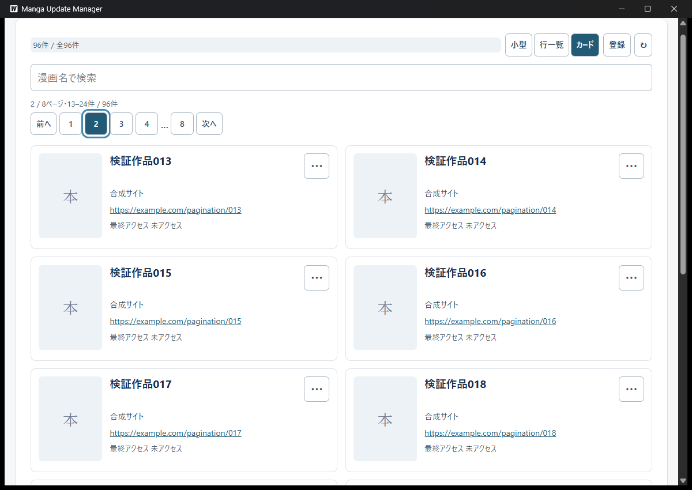

# 一覧ページ切替の検証

Issue #238。2026-10-25、基準main `9a4b93e9360c24e1f654cd0ba99e6a1b921a3b5c`へページ制御を追加して確認した。登録・形式復元の応答順も自動テストで制御し、実Wails APIを通る確認と分けた。

## 対象と方法

Go指定1.26.0、使用Go1.26.5（windows/amd64）、Wails v2.16.0。TypeScript解析とproduction frontendビルド後、`go run github.com/wailsapp/wails/v2/cmd/wails@v2.16.0 build -s -m -nosyncgomod -o 238-pagination-check.exe`で生成した。exeのSHA-256は`9e2676197aa89cfd15edc5ae5ff853ff4600318d29b057efd4f0e164806270bc`。製品コードはレビュー用index tree `19615fdd26b654d9726b82cc1854e011785e3805`と同じで、その後の追加はテストと文書だけである。

専用APPDATA/TEMP、合成96作品、未設定・欠損画像、合成PNGを使用した。通常のDB・画像・履歴・設定へアクセスしない。補助はPID、exeの絶対パス、専用保存先の目印を照合した。画像選択中の無効な親を強制前面化せず、終了は通常終了だけで行った。Windows文字サイズは既存の110%のままとし、OS設定を変更しない。

## 実WebView2確認

| 条件 | 観測した結果 |
| --- | --- |
| 件数と境界 | カード12件、小型/行20件。カード8ページ目では最後の合成作品096を表示し、次へは無効。小型/行5ページ目は残り16件となった |
| 上下の操作 | 下側の2ページ目操作から先頭へ戻り、上側の2ページ番号へフォーカスした。利用者も下側「次へ」のTab・Enterと移動後のフォーカスを確認し、問題なしと回答した |
| 多数ページ | 初期カードは8ページとなり、先頭・末尾・現在付近の番号と省略を表示した |
| 狭い幅 | 幅1200pxから640pxへ縮めても、カード8ページ目の作品085–096と件数を維持した。行は狭い幅の画面とページ操作を確認した。表内横スクロールの実操作は#237の確認と区別する |
| 検索と形式 | 末尾の作品096を検索すると1ページ目の1件となり、不一致は既存案内とページ操作なしで表示した。形式変更でも1ページ目へ戻った |
| IME | 利用者が2ページ目以降で日本語入力を確認し、変換中はページを維持、確定後は1ページ目へ戻ることに問題なしと回答した |
| 登録と再読込 | 合成「登録確認作品」を登録し、97件目の9ページ目へ移動した。フォーカスも上側9ページ番号へ移り、再読込後も9ページ目を維持した |
| 削除による補正 | 9ページ目に唯一ある登録確認作品を削除すると、残る最後の8ページ目へ補正し、空の9ページ目は残らなかった |
| 編集 | 8ページ目の合成作品096のタイトルを編集しても、作品085以降を表示する現在ページを維持した |
| 画像処理中の移動 | 4000×5000pxの合成画像で処理中表示を観測して2ページ目へ移動した。移動後も処理中表示が残り、非表示の作品の処理が完了した |
| 部分成功と警告 | 専用の旧管理画像を一時的に開いて削除を拒否し、新画像設定の成功と整理警告を共存させた。1ページ目への復帰・再び2ページ目への移動でも警告を保持した。ハンドルはfinallyで閉じた |
| 非表示作品の通知 | 2ページ目から画像通知を閉じると、1ページ目へ移動せず検索欄へフォーカスした |
| 再起動 | 行一覧3ページ目で通常終了・再起動し、形式は行一覧、ページは1ページ目、検索は空欄となった。最後の確認用アプリも通常終了した |

## 自動テストと回帰

`App.pagination.test.tsx`で0/1/12/13/24/25件、各形式の固定件数、600件の番号省略、上下のキー操作、IME、検索・形式変更、再読込の増減、StrictModeの古い応答と再マウント、登録の一致/不一致/一覧失敗/後続操作、編集・削除による補正、モーダルガード、URL/画像処理中の往復と通知を確認する。

実装中の確認で、登録待機中に形式復元が終わると登録開始時の古いページサイズで移動先を計算するケースを発見した。24件から25件目を登録し、cardsからrowsの復元を遅延させるテストで、期待する2ページ目ではなく1ページ目へ戻る失敗を再現した。

登録の結果は作品ID/登録日時と操作番号で保持し、現在の形式復元を待って、描画後の検索結果とサイズから移動先を計算する形へ修正した。登録応答が復元より先/後の両方を確認する。後続操作があれば自動移動だけを中止し、登録成功を取り消したり再登録したりしない。

## 補助の失敗と限界

フォーム閉鎖直後の編集メニュー取得が失敗したため、配置を待ち、対象作品へフォーカスしてから再開した。画像選択でも最初の「開く」のUIAパターン取得が失敗した。続けた終了補助は親が無効なため通常終了せず停止した。補助へ背景操作の有効状態チェックと、開くボタンのID・InvokePattern待機を加え、現在の選択画面から再開した。製品コードや受付条件を緩めたわけではなく、これらを製品の回帰テスト失敗とは扱わない。

実画面で応答順・全競合・URL起動中のページ移動を再現したわけではない。遅延と古い応答、URLの二重受付防止、編集で検索から外れる場合の補正はDOMテストの範囲である。画像の整理警告も合成ハンドル保持によるもので、実ディスク故障やOS全体の権限変更ではない。

全件取得は維持しており、ページ切替だけで通信量や全件保持のメモリが減るとは扱わない。画像取得とカード描画は当該ページへ限定する。ページ番号は永続化せず、新しいDB/API/依存を追加しない。タグ・並び順・予定等を含むADR-0005全体のPendingは維持する。
