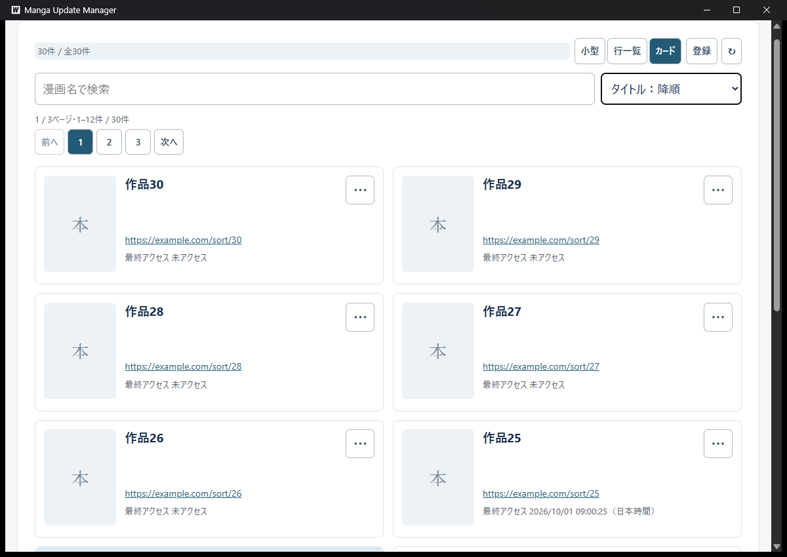
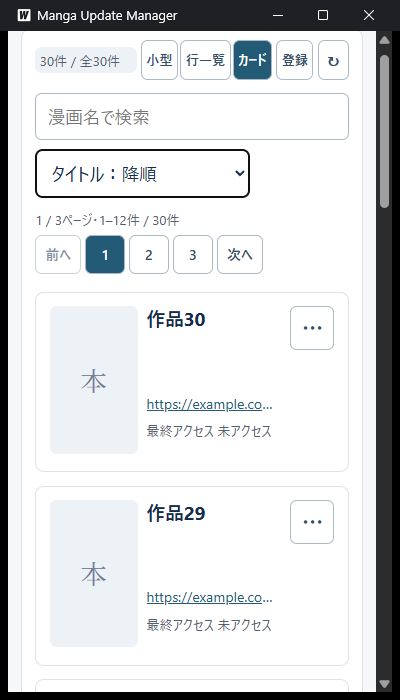

# 基本並び順の検証（Issue #258）

## 対象

- ベース: `77ea355252c1baf48030c93753e3c4c079bb8dd5`（PR #260）。確認日: 2026-10-25。
- Go 1.26.5 / Wails v2.16.0で専用production exeを作成した。最終exeのSHA256は`831d954e053e2e1ba40fe29c88310a7f98eedce6f425dc1f546f67ca98d442cd`。製品のDB/APIは変更せず、#257の保存APIへ画面を接続する。
- 利用者DBと分けたAPPDATA・TEMP・WebView2領域へ合成30作品を登録する。URLはexample.comだけで、実ブラウザー起動やサイトアクセスは行わない。
- タイトルは作品1〜30のうちID3を作品02とし、ID1〜25に順序の分かる合成アクセス時刻、ID26〜30に未アクセスを用意する。

## 自動確認

- 比較器: 自然順、ゼロ埋め同順位、全半角・大小、結合文字、かな・互換記号の区別、大きな整数、同時刻の時差表現、同一ミリ秒内のナノ秒差、未設定の両方向末尾、元配列・保存値の不変。
- DOM: 3形式と全件整列後のページ分割、検索とフォーカス、StrictModeの古い復元破棄、未知値・読込失敗の非修復、共通要求列・古い保存失敗、アンマウント、登録と初期復元の両応答順、後続操作、アクセス保存・古い一覧・通知、編集と背景モーダル操作、画像処理中の整列。
- frontend全体197テスト、TypeScript/Viteビルド、専用Wails productionビルドが成功。比較器6件と画面接続15件を含む。新しいGo実装は追加していない。
- 独立レビューでDate.parseがナノ秒差を失うwantを受けた。ID1の200nsとID2の100nsが古い順で誤ってID順になる反例を追加し、修正前の失敗を再現した。秒部分と9桁の小数部分の別比較へ修正し、時差と小数桁数の違いもテストした。

## 実画面と補助の限界

- 通常幅の検索右に6択を配置した画面と、登録新しい順の1ページ目で作品30から始まる表示を観測した。日時精度修正前のexeでは利用者がタイトル昇順の作品1→作品2→作品02→作品4…作品10と、Tab・上下キー後も選択欄で操作できることを確認した。精度修正は日時比較だけで、選択UI・タイトル比較は変更していない。
- UIA補助の最初の実行はフォーカス条件で停止した。次の実行は前回と同じ選択でページリセットを期待する前提が誤り、停止した。UIAのValuePatternによる値指定も整列完了の判定に使えなかった。閉じた選択欄へのCollapseは無効状態として拒否された。
- キー操作補助は前面ウィンドウが確認用アプリでない場合に停止し、別アプリへキーを送って続行しない。無効な親ウィンドウの強制前面化・強制終了は行わない。補助の失敗を製品の不具合とも検証成功とも扱わない。
- 最終exeでは起動直後に前面と有効状態を確認してHome・下キーでタイトル降順を選び、作品30から始まることを確認した。保存中表示がなくなった後、2ページ目から通常終了し、同じ専用保存先で再起動した。タイトル降順の復元・1ページ目へのリセットを確認し、再度通常終了した。
- 幅1200pxでは検索右、400pxでは検索下へ折り返し、選択欄が画面内に収まることを最終exeの画像で確認した。OS文字サイズは既存の110%を維持し、他倍率との比較は行わない。
- 6順序すべての実画面確認、実WebView2でのアクセス保存・画像処理中の並び替えは未実施で、DOMの確認範囲と区別する。画面から実URLを開く試験は行わない。
- 保存失敗・未知値・処理中の整列はDOMで確認し、実ディスク故障や実WebView2の故障注入は行わない。実利用者データ・OSの文字サイズ設定は変更しない。

## 最終exeの画面

